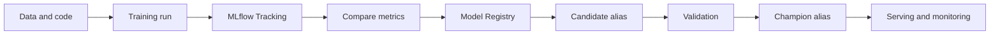

# MLflow Learning Lab

[](https://github.com/ghazalehgholinejad/mlflow-learning-lab/actions/workflows/tests.yml)

A bilingual, hands-on course for learning **MLOps fundamentals with MLflow**. It is designed to run locally on CPU and uses a public dataset bundled with scikit-learn.

**Requirements:** Python 3.9 or newer.

## Why this repository exists

Training a model is only one part of an ML system. Teams also need to answer: Which data and parameters produced this result? Which model should be deployed? Can another person reproduce it? MLflow provides tracking, model packaging, a registry, and lifecycle metadata that help answer these questions. MLOps is the broader engineering practice covering repeatable training, testing, delivery, monitoring, governance, and collaboration; MLflow is one tool inside that practice.



## The four projects

| Project | What you learn | Command |
|---|---|---|
| 01 — Experiment tracking | parameters, metrics, tags, artifacts, model signatures | `python projects/01_track_experiment.py` |
| 02 — Model comparison | repeatable comparison, leaderboard, selection tags | `python projects/02_compare_models.py` |
| 03 — Model registry | versions, tags, `candidate` and `champion` aliases | `python projects/03_registry_aliases.py --promote` |
| 04 — Quality gate | validation policy, regression checks, promotion report | `python projects/04_quality_gate.py --promote` |

## Quick start

```bash
python -m venv .venv
source .venv/bin/activate
python -m pip install -e '.[dev]'
python projects/01_track_experiment.py
mlflow server --backend-store-uri sqlite:///mlflow.db --host 127.0.0.1 --port 5000
```

Open `http://127.0.0.1:5000`. Run the other projects in a second terminal while the server is open. Generated databases, artifacts, plots, and reports are intentionally ignored by Git.

## Learning path

1. Read the [English course](docs/COURSE_EN.md) or [جزوهٔ فارسی](docs/COURSE_FA.md).
2. Run project 01 and inspect every logged field in the UI.
3. Change one hyperparameter and explain the new run before comparing it.
4. Run project 02 and inspect `reports/leaderboard.csv`.
5. Run project 03 first without and then with `--promote`.
6. Run project 04, inspect `reports/promotion-report.json`, and deliberately make a threshold fail.
7. Complete the exercises at the end of either course.

## Scope and honest limitations

This is a local learning lab, not a production platform. It teaches experiment lineage and model lifecycle mechanics. A production MLOps system also needs remote artifact storage, access control, secrets management, CI/CD deployment, data validation, drift monitoring, rollback policies, and infrastructure observability.

## References

- [MLflow Tracking](https://mlflow.org/docs/latest/ml/tracking/)
- [MLflow Model Registry](https://mlflow.org/docs/latest/ml/model-registry/)
- [Model signatures and input examples](https://mlflow.org/docs/latest/ml/model/signatures/)

## License

MIT
